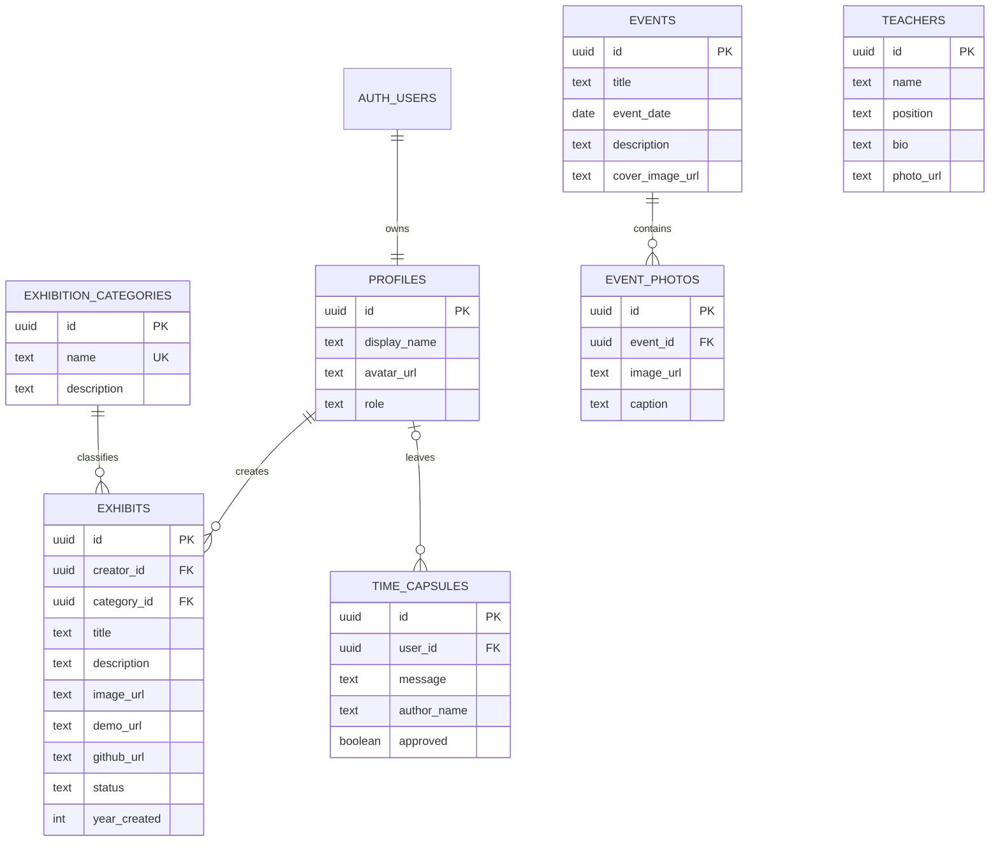

# ISM Digital Museum: architecture and demo plan

## Data model (ERD)



The `exhibits.category` text remains for compatibility with the current UI. A database trigger resolves it to the required `category_id` foreign key. `profiles.id` references Supabase Auth's `auth.users.id`; the other relationships are shown above.

## Low fidelity wireframe

```text
┌──────────────────────────────────────────────────────┐
│ ISM ARCHIVE       Үзэсгэлэн  Түүх  Хүмүүс  Үйл явдал │
├──────────────────────────────────────────────────────┤
│ HERO: Ирээдүйн архив       Онцлох бүтээлийн зураг    │
│ [Музей үзэх] [Бидний түүх]                            │
├──────────────────────────────────────────────────────┤
│ ҮЗМЭРИЙН ЖАГСААЛТ                                    │
│ [Хайлт] [Ангилал]    [Бүтээлийн картууд...]          │
├──────────────────────────────────────────────────────┤
│ ТҮҮХИЙН TIMELINE                                     │
├──────────────────────────────────────────────────────┤
│ БАГШИЙН КАРТУУД       ОЮУТНЫ БҮТЭЭЛЧИД              │
├──────────────────────────────────────────────────────┤
│ ҮЙЛ ЯВДЛЫН КАРТУУД → зургийн цомог                  │
├──────────────────────────────────────────────────────┤
│ ОЮУТНЫ ПРОФАЙЛ / МИНИЙ БҮТЭЭЛҮҮД                    │
├──────────────────────────────────────────────────────┤
│ ЦАГИЙН КАПСУЛ → хянагдсан захианы хана              │
└──────────────────────────────────────────────────────┘
```

## 5–7 minute presentation flow

1. **0:00–0:45 — Purpose:** Explain how student work, department history, and shared memories come together in one digital museum.
2. **0:45–2:00 — Browse:** Search exhibits by title, year, category, and technology; open a detail card and follow its demo/GitHub links.
3. **2:00–3:00 — People and events:** Open a teacher bio, browse the student creator cards, and view an event photo gallery.
4. **3:00–4:15 — Creator workflow:** Sign in, update a profile, submit an exhibit with an image and links, then show its pending review status.
5. **4:15–5:30 — Administration and safety:** Show admin CRUD, capsule review, RLS policies, and the private service-role boundary.
6. **5:30–6:30 — Creative detail:** Invite a visitor to leave a note for a future student; explain that only approved notes appear on the capsule wall.
7. **6:30–7:00 — Wrap up:** Summarize the archive's value and identify where verified department data will be maintained.

Before a public presentation, replace the sample teachers, events, and historical dates with department-approved information and configure a live Supabase project.
